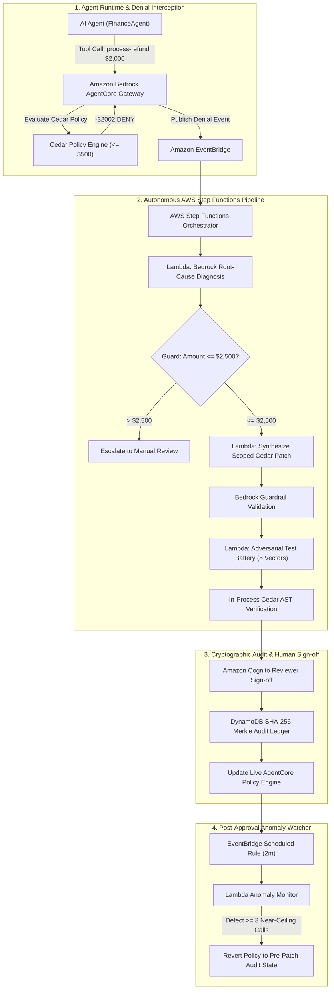
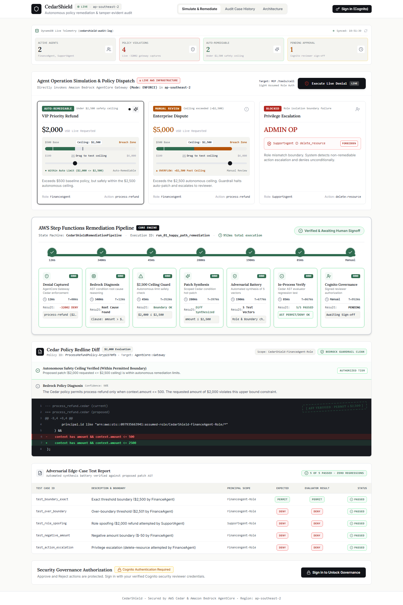
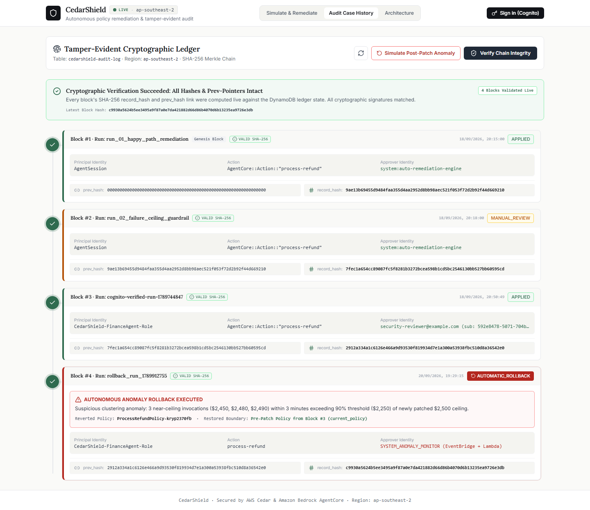
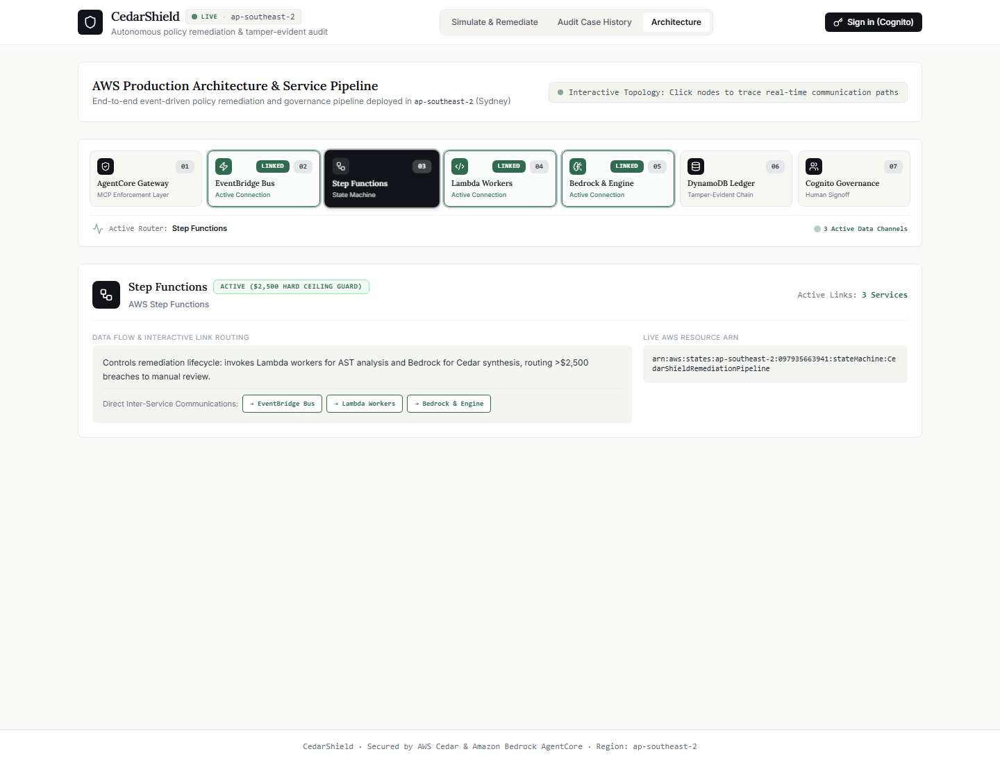

# CedarShield

### Autonomous Authorization Drift Diagnosis, Remediation, and Governance for AI Agents

[](https://aws.amazon.com/bedrock/)
[](https://aws.amazon.com/step-functions/)
[](https://www.cedarpolicy.com/)
[](https://aws.amazon.com/dynamodb/)
[](https://aws.amazon.com/cognito/)
[](LICENSE)

---

## Overview

When enterprise AI agents invoke operational tools (such as payment processing, infrastructure provisioning, or database access) and trigger authorization failures, default architectures return uninformative `-32002 DENY` errors. Operations stall while security and platform engineers manually inspect policy logs, formulate condition updates, test edge cases, and deploy changes.

**CedarShield** provides an automated policy remediation and governance pipeline for AI agents operating over Amazon Bedrock AgentCore and the Model Context Protocol (MCP):

1. **Interception**: Captures runtime authorization denials emitted by Amazon Bedrock AgentCore and MCP gateways.
2. **Diagnosis**: Analyzes Cedar AST root causes using Amazon Bedrock foundation models with confidence metrics.
3. **Safety Ceiling**: Enforces an autonomous upper bound (`$2,500`) that routes higher-risk transactions to human review.
4. **Patch Synthesis & Verification**: Synthesizes minimally scoped Cedar condition diffs and validates them through a 5-vector adversarial test suite (boundary, over-boundary, role spoofing, negative inputs, and action escalation).
5. **Human-in-the-Loop Governance**: Gates policy application behind cryptographic Amazon Cognito reviewer sign-off.
6. **Audit Ledger**: Records every decision, diff, and verification hash in a tamper-evident SHA-256 Merkle chain in Amazon DynamoDB.
7. **Anomaly Detection & Rollback**: Monitors post-approval execution traffic via EventBridge and Lambda to autonomously revert near-ceiling exploitation patterns by restoring pre-patch policies directly from ledger history.

---

## Operational Status & Public Sandbox

| Component | Operational Status |
| :--- | :--- |
| **Public Dashboard** | **[https://cyber-del.github.io/CedarShield/](https://cyber-del.github.io/CedarShield/)** |
| **Execution Mode** | **Synthetic Sandbox Mode** (Deterministic client-side evaluation; zero live credential dependency or billing risk) |
| **Deployment History** | Deployed during the hackathon in a temporary AWS sandbox; following hackathon conclusion, the public dashboard operates permanently in synthetic mode. |
| **Cost & Abuse Controls** | Codified in `infra/template.yaml` (AWS Budget alarm at 80%/100% and API Gateway 5 req/sec route throttling; ready for deployment in a dedicated account). |

> **Security Note**: The public dashboard runs in a decoupled synthetic evaluation mode. Visitors can simulate policy denials, review Cedar AST diffs, run the 5-test adversarial boundary battery, and verify SHA-256 Merkle chain integrity without requiring live AWS credentials or initiating billable foundation model invocations.

---

## Architecture

### System Workflow



---

## User Interface & Operational Panels

### 1. Simulate & Remediate Dashboard
Interactive scenario evaluation, 7-stage Step Functions pipeline tracking, Cedar policy redline diffs, adversarial test battery, and Cognito sign-off drawer.

<p align="center">
  
</p>

| Panel / Component | Function & Capability |
| :--- | :--- |
| **Telemetry Summary** | Tracks active agents (`FinanceAgent`, `SupportAgent`), captured policy denials, auto-remediable incidents, and pending approvals. |
| **Scenario Cards** | Three interactive scenarios: **VIP Priority Refund ($2,000)** (auto-remediable), **Enterprise Dispute ($5,000)** (escalates past $2.5k ceiling), and **Privilege Escalation** (role boundary block). |
| **7-Stage Pipeline Tracker** | Real-time stage tracking: `Denial Captured` $\rightarrow$ `Bedrock Diagnosis` $\rightarrow$ `$2,500 Ceiling Guard` $\rightarrow$ `Patch Synthesis` $\rightarrow$ `Adversarial Battery` $\rightarrow$ `In-Process Verify` $\rightarrow$ `Cognito Governance`. |
| **Cedar Policy Diff** | Monospace syntax-highlighted diff comparing live condition (`context.amount <= 500`) against scoped patch (`context.amount <= 2500`). |
| **Adversarial Test Suite** | 5 automated boundary test cases (`test_boundary_exact`, `test_over_boundary`, `test_role_spoofing`, `test_negative_amount`, `test_action_escalation`) with 100% pass verification. |
| **Cognito Governance Drawer** | Human-in-the-loop authorization with Cognito identity verification. |

---

### 2. Cryptographic Audit Ledger & Anomaly Rollback
Tamper-evident SHA-256 Merkle chain verification and automated post-patch anomaly detection.

<p align="center">
  
</p>

| Block / Stage | Description & Verification Proof |
| :--- | :--- |
| **Cryptographic Status** | Verification banner confirming all SHA-256 hashes and prev-pointers are mathematically intact (`4 Blocks Validated Live`). |
| **Block #1 (Genesis)** | Initial remediation execution (`run_01_happy_path_remediation` - `APPLIED`). |
| **Block #2 (Ceiling Breach)** | $5,000 transaction exceeding ceiling safely routed to manual review (`MANUAL_REVIEW`). |
| **Block #3 (Cognito Sign-Off)** | Production patch applied following authorized security reviewer verification (`APPLIED`). |
| **Block #4 (Anomaly Rollback)** | Anomaly watcher detected 3 near-ceiling invocations ($2,450, $2,480, $2,490) in 3 minutes ($\ge 90\%$ threshold). Dynamically pulled pre-patch policy from Block #3 and restored baseline state on the policy engine. |

---

### 3. Architecture Topology & Cloud Resources

<p align="center">
  
</p>

| Component | Cloud Resource / ARN | Role in Infrastructure |
| :--- | :--- | :--- |
| **AgentCore Gateway** | AgentCore MCP Gateway (`us-east-1`) | Enforces Cedar policy evaluation on all tool calls. |
| **EventBridge Bus** | `arn:aws:events:<REGION>:<ACCOUNT_ID>:event-bus/default` | Dispatches policy violation events and anomaly triggers. |
| **Step Functions** | `arn:aws:states:<REGION>:<ACCOUNT_ID>:stateMachine:CedarShieldRemediationPipeline` | Orchestrates 7-stage serverless remediation lifecycle. |
| **Bedrock & Policy Engine** | `CedarShieldPolicyEngine-Core` | Bedrock diagnosis and live Cedar policy evaluation. |
| **DynamoDB Audit Ledger** | `cedarshield-audit-log` | Immutable SHA-256 Merkle hash chain storing all decisions. |
| **Cognito Governance** | User Pool `<COGNITO_USER_POOL_ID>` | RBAC authentication for security reviewer sign-off. |

---

## Repository Structure

```
.
├── docs/
│   ├── THREAT_MODEL.md         # Comprehensive STRIDE / boundary threat model
│   └── DEPLOYMENT.md           # AWS SAM guided deployment instructions
├── frontend/                   # React + Vite + TailwindCSS governance dashboard
│   ├── src/                    # UI components, state management, and synthetic API client
│   └── dist/                   # Production build assets deployed to GitHub Pages
├── infra/
│   ├── template.yaml           # AWS SAM Infrastructure as Code (IaC) template
│   ├── samconfig.toml          # SAM deployment configuration
│   └── *.json                  # IAM trust and permission policy definitions
├── policies/
│   ├── baseline_policy.cedar   # Reference initial Cedar authorization policy
│   └── patched_policy.cedar    # Scoped remediated Cedar policy condition
├── screenshots/                # Walkthrough and architectural screenshots
├── scripts/
│   ├── pulseguard_scanner.py   # Repository static analysis and secret detection tool
│   ├── publish_gh_pages.py     # Clean single-commit GitHub Pages deployment script
│   └── revoke_cognito_credentials.py # Administrative credential containment utility
├── src/
│   ├── functions/              # Lambda workers (Diagnose, Patch, Verify, API routes)
│   ├── anomaly_monitor.py      # Post-approval velocity monitor & rollback handler
│   ├── agent_gateway_client.py # SigV4 AgentCore MCP client utility
│   └── server.py               # Local development server and mock API router
├── tests/
│   ├── test_e2e_regression.py  # End-to-end remediation pipeline regression test
│   ├── verify_audit_chain.py   # DynamoDB SHA-256 Merkle chain verification script
│   └── simulate_anomaly_and_rollback.py # Anomaly clustering & rollback verification
├── pyproject.toml              # Python package metadata and tool configurations
├── requirements.txt            # Python dependencies
├── SECURITY.md                 # Security policy and vulnerability disclosure process
├── LICENSE                     # MIT License
└── README.md
```

---

## Getting Started

### Prerequisites
- Python 3.10+
- Node.js 18+ & npm
- AWS CLI v2 configured with active credentials (`aws sts get-caller-identity`)

### 1. Clone & Install Dependencies

```bash
# Clone the repository
git clone https://github.com/cyber-del/CedarShield.git
cd CedarShield

# Install Python dependencies
pip install -r requirements.txt

# Install Frontend dependencies
cd frontend
npm install
cd ..
```

### 2. Local Development Server

Run the local backend API server:
```bash
python src/server.py
```

In a separate terminal, launch the frontend dashboard:
```bash
cd frontend
npm run dev
```

Open [http://localhost:3000](http://localhost:3000) in your browser.

---

## AWS SAM Deployment

To deploy the full serverless architecture to a dedicated AWS account:

```bash
# 1. Validate the SAM template
sam validate -t infra/template.yaml

# 2. Build Lambda packages
sam build -t infra/template.yaml

# 3. Deploy guided stack
sam deploy --guided -t infra/template.yaml
```

For complete deployment parameters, parameter overrides, and cost configurations, refer to the [AWS SAM Deployment Guide](docs/DEPLOYMENT.md).

---

## Testing & Verification

Run the test harnesses from the repository root:

```bash
# 1. Run full E2E pipeline regression
python tests/test_e2e_regression.py

# 2. Verify SHA-256 Merkle hash chain integrity
python tests/verify_audit_chain.py

# 3. Simulate post-approval anomaly clustering and dynamic rollback
python tests/simulate_anomaly_and_rollback.py

# 4. Run PulseGuard security and secret scanner
python scripts/pulseguard_scanner.py
```

---

## Security Model & Threat Model

CedarShield enforces several core security guarantees:
1. **Deterministic Safety Ceiling**: Transactions with `amount > $2,500` cannot be autonomously approved by LLM workflows and require human reviewer sign-off.
2. **Explicit Principal Binding**: Cedar policies bind principals via canonical IAM role ARNs; wildcard principal expansion is rejected.
3. **Patch Guardrails**: Active validation rules block condition stripping (`when { true }`) and unconstrained permissions.
4. **Tamper-Evident Ledger**: DynamoDB ledger entries compute cryptographic SHA-256 hashes linking back to genesis (`0x00...00`).
5. **Dynamic Rollback**: The anomaly rollback engine restores the pre-patch policy from the audit record dynamically without hardcoded assumptions.

For complete architectural threat vectors and mitigations, review the [CedarShield Threat Model](docs/THREAT_MODEL.md).

---

## Security Policy

For vulnerability reporting guidelines and coordinated disclosure procedures, please see [SECURITY.md](SECURITY.md).

---

## License

Distributed under the MIT License. See [LICENSE](LICENSE) for details.
