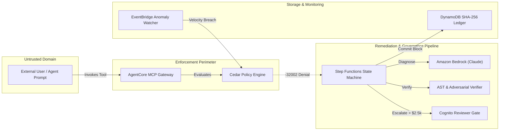

# CedarShield Threat Model

## 1. System Overview & Scope
CedarShield provides an automated policy diagnosis, patch synthesis, and governance layer for autonomous AI agents executing tools over Amazon Bedrock AgentCore and the Model Context Protocol (MCP).

This document outlines the assets, trust boundaries, threat vectors, and deterministic mitigations implemented across the architecture.



---

## 2. Assets & Trust Boundaries

| Asset | Description | Sensitivity |
| :--- | :--- | :--- |
| **Cedar Policy State** | Live rules controlling agent access to production tools (`process-refund`, `delete-resource`, `read-record`). | **High**: Unauthorized modification enables arbitrary tool execution. |
| **Autonomous Safety Ceiling** | The hard `$2,500` upper limit for automated self-healing. | **Critical**: Breaching this enables unauthorized high-value financial actions. |
| **Audit Ledger Chain** | Historical SHA-256 Merkle blocks documenting all denials, proposed patches, and approvals. | **High**: Must be tamper-evident to satisfy SOC2 / ISO compliance. |
| **LLM Synthesis Boundary** | Prompts dispatched to Amazon Bedrock for Cedar condition analysis. | **Medium**: Vulnerable to prompt injection or hallucinated policy syntax. |

---

## 3. Threat Vectors & Mitigations

### Threat 1: Prompt Injection / Adversarial Patch Synthesis
* **Threat**: A prompt injected into agent tool parameters attempts to manipulate Amazon Bedrock during patch generation into returning a permissive policy (e.g. `when { true }` or wildcard permissions `permit(principal, action, resource)`).
* **Impact**: Total authorization bypass across all agent tools.
* **Mitigations**:
  1. **Strict Guardrail Filtering**: The synthesis engine in `src/functions/generate-patch/app.py` actively validates that generated Cedar diffs contain scoped conditions and explicitly rejects `when { true }` or omitted conditions (verified in `tests/test_cedar_conditions.py`).
  2. **5-Vector Adversarial Test Battery**: Before any patch is proposed, Lambda executes automated boundary tests:
     - Exact boundary verification (`context.amount == boundary`).
     - Over-boundary rejection (`context.amount == boundary + 1` must DENY).
     - Role spoofing rejection (`principal.id != authorized_role` must DENY).
     - Negative input rejection (`context.amount < 0` must DENY).
     - Action escalation rejection (`action != permitted_action` must DENY).
  3. **AST Syntax Compilation**: Patches are compiled through the Cedar AST engine; malformed or ambiguous statements fail immediately.

---

### Threat 2: Autonomous Safety Ceiling Breach
* **Threat**: An AI agent issues a high-risk request (e.g., $5,000 refund) and triggers an autonomous self-healing loop to expand its own authorization beyond safe organizational limits.
* **Impact**: Financial or operational damage from unreviewed high-value transactions.
* **Mitigations**:
  1. **Deterministic State Machine Ceiling**: In AWS Step Functions, a dedicated Choice state enforces the hard autonomous safety ceiling of `$2,500`.
  2. **Mandatory Human-in-the-Loop Escalation**: While transactions within the ceiling (e.g., $2,000 VIP refund expanding baseline $500 limit) can be autonomously remediated, any request exceeding `$2,500` is unconditionally routed to `AwaitApprovalState`. Automated progression halts until an authorized human security reviewer signs off via Amazon Cognito.

---

### Threat 3: Principal Spoofing & Identity Confusion
* **Threat**: An untrusted Lambda, support agent, or external caller assumes an identity that triggers permissions granted to a high-privilege agent (e.g., `FinanceAgent`).
* **Impact**: Privilege escalation across segregated organizational boundaries.
* **Mitigations**:
  1. **Exact IAM Role ARN Binding**: Cedar policies bind principals using exact IAM role ARNs rather than substring wildcards:
     ```cedar
     permit (
         principal is AgentCore::IamEntity,
         action == AgentCore::Action::"process-refund",
         resource == AgentCore::Gateway::"<GATEWAY_ARN>"
     )
     when {
         principal.id == "arn:aws:iam::<ACCOUNT_ID>:role/CedarShield-FinanceAgent-Role" &&
         context has amount && context.amount <= 2500
     };
     ```
     *(Exact equality prevents substring matching flaws where `AttackerFinanceAgentRole` would match `*FinanceAgent*`)*.
  2. **SigV4 Authentication**: All tool calls to the AgentCore Gateway require valid AWS SigV4 signed headers; caller identity is verified by AWS IAM before reaching policy evaluation.

---

### Threat 4: Post-Approval Policy Drift & Near-Ceiling Exploitation
* **Threat**: Following a legitimate policy expansion (e.g., condition expanded from $500 to $2,000), an adversary or runaway agent issues repeated transactions just beneath the new boundary ($1,950, $1,980, $1,990) to siphon funds without tripping the boundary denial.
* **Impact**: Financial loss accumulated across multiple micro-breaches.
* **Mitigations**:
  1. **Sliding-Window Velocity Detection**: Amazon EventBridge routes tool invocations to a Lambda Anomaly Watcher that tracks rolling 3-minute windows.
  2. **Autonomous Dynamic Rollback**: If $\ge 3$ transactions occur within $90\%$ of the active ceiling within a 3-minute window, the anomaly engine automatically pulls the pre-patch policy from the DynamoDB audit record and restores the original baseline on the AgentCore Policy Engine during the next monitoring cycle.

---

### Threat 5: Audit Ledger Tampering
* **Threat**: A compromised administrative credential or rogue operator modifies historical transaction records in DynamoDB to cover up unauthorized actions.
* **Impact**: Loss of audit integrity and regulatory non-compliance.
* **Mitigations**:
  1. **Linear Cryptographic SHA-256 Hash Chaining**: Every ledger block computes:
     $$\text{record\_hash} = \text{SHA256}(\text{prev\_hash} + \text{run\_id} + \text{action} + \text{amount} + \text{status} + \text{timestamp})$$
  2. **Sequential Validation**: Genesis block starts at `0x00...00`. Any retroactive mutation of block $N$ breaks $\text{prev\_hash}$ continuity for all subsequent blocks $N+1 \dots M$.
  3. **Architectural Limitation & External Anchoring**: A linear hash chain detects tampering by non-privileged readers. However, an attacker with full DynamoDB write access could rewrite the entire table and recompute valid hashes. To prevent full ledger rewrite attacks in production, the head hash should be anchored to an immutable external target (e.g., S3 Object Lock in Compliance Mode, Amazon QLDB, or a cryptographically signed public witness).

---

### Threat 6: Public Exposure & Resource Exhaustion (DoS)
* **Threat**: Exposure of public demo endpoints leading to denial-of-service, excessive Amazon Bedrock model invocations, or unbounded cloud spend.
* **Impact**: Service unavailability and high AWS bills.
* **Mitigations**:
  1. **Synthetic Public Sandbox**: The public dashboard runs in a decoupled synthetic evaluation mode with zero live model invocation dependencies.
  2. **Codified API Gateway Throttling**: `infra/template.yaml` defines `ThrottlingRateLimit: 5` req/sec and `ThrottlingBurstLimit: 10`.
  3. **Codified AWS Budget Alarms**: Monthly budget set to `$20 USD` triggering SNS notifications at 80% ($16) and 100% ($20).
